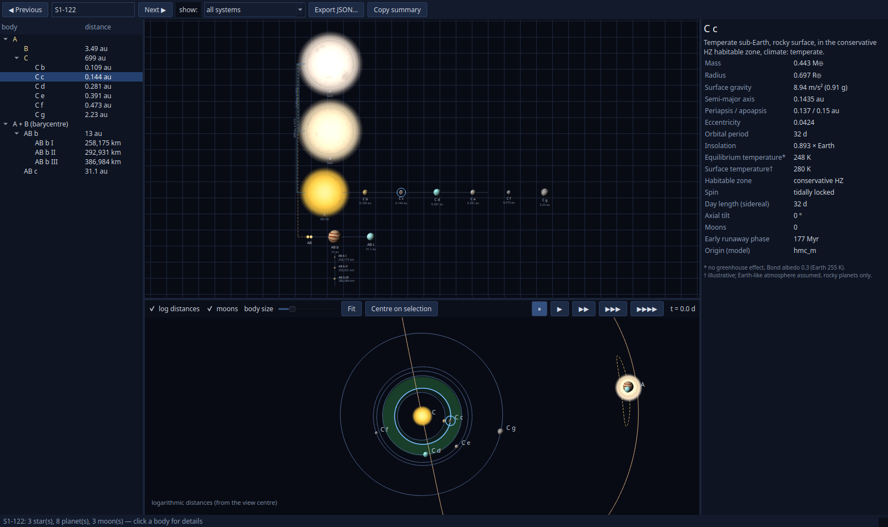
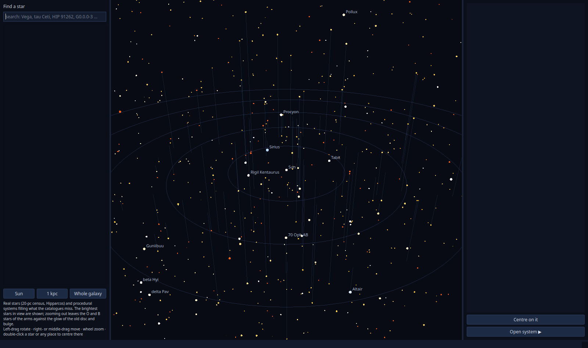
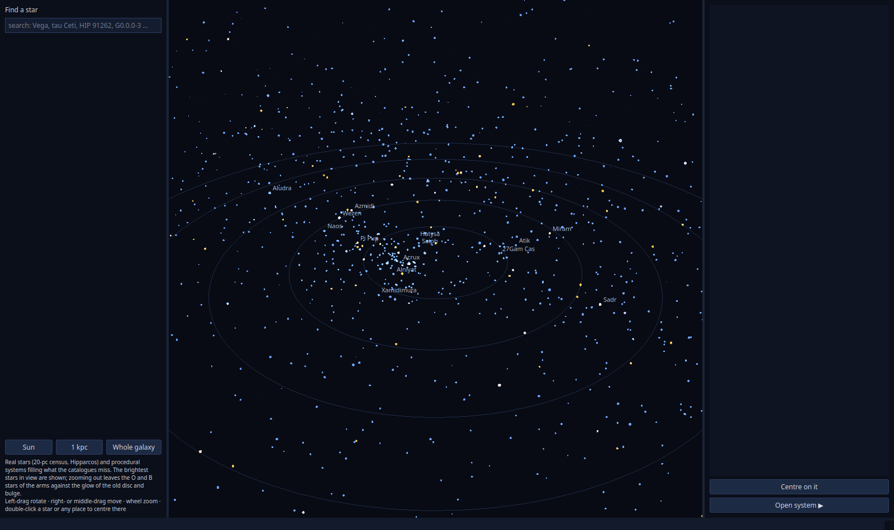
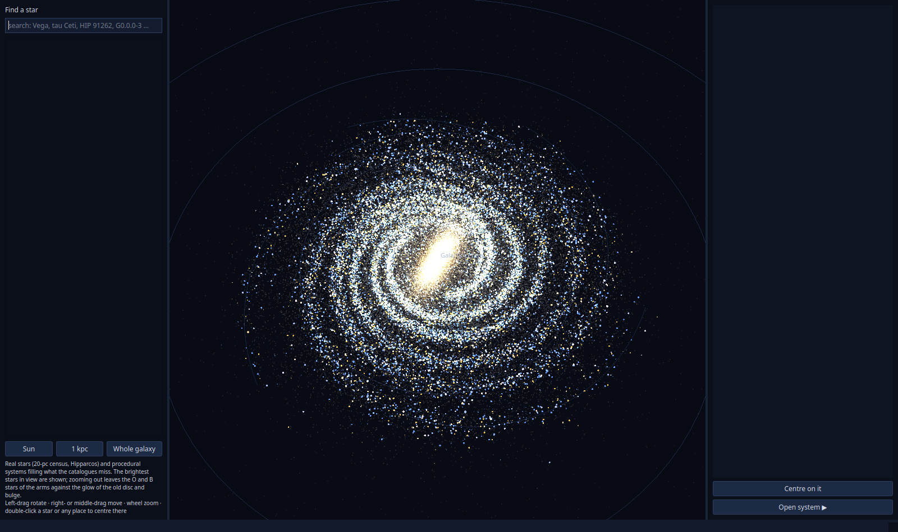
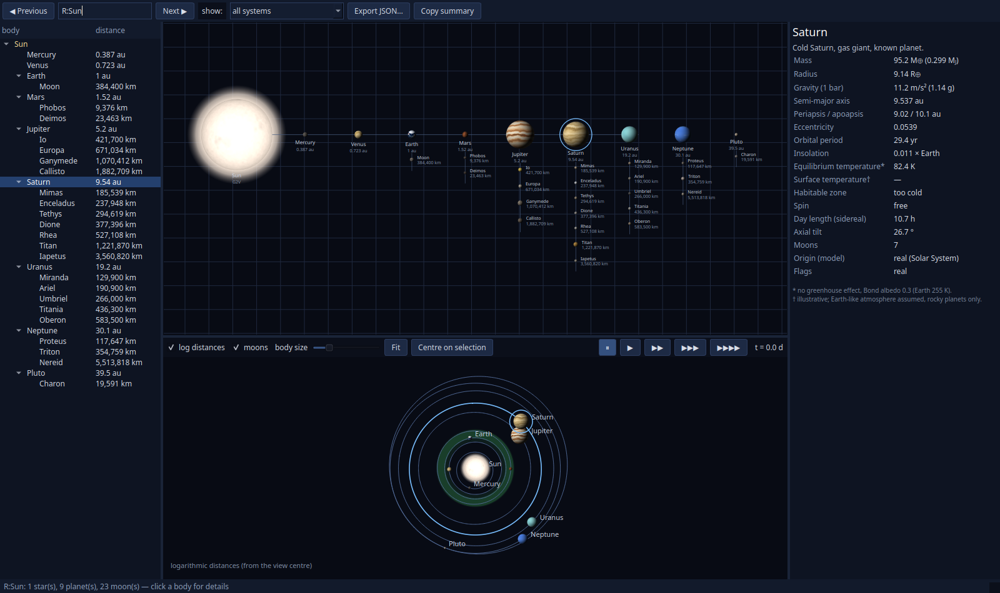

# Realistic Star System Generator

A star-system generator for worldbuilding that aims at the best scientific accuracy reasonably
achievable. It draws stars, planets and moons with the abundances the Galaxy actually has,
places them in a 3D model of the Milky Way among the real stars, and can generate the planetary
system of a real, named star, consistent with its known planets and with what surveys would
have found.



*The system viewer on `S1-122`, a generated triple system:*
- *G2 and K0 stars (A and B) in a 3.5-au orbit, with two circumbinary planets;*
- *an M2.5 dwarf (C) 700 au away, with six planets of its own;*
- *the selected planet `C c`, a temperate, tidally locked sub-Earth in the conservative habitable zone.*

*Top: hierarchical system map. Bottom: orbit view at true separations. Right: plain-language
details of the selected body.*

## What it does

- **Random systems with realistic abundances.** Stellar masses, multiplicity, ages and
  metallicities come from the 20-pc census of the solar neighbourhood (Kirkpatrick et al. 2024),
  so most systems are M dwarfs, as in reality.
  - Stars are evolved with MIST, BHAC15 and ATMO tracks; remnants follow white-dwarf cooling tables.
  - Hierarchical triples and quadruples obey the Mardling & Aarseth (2001) stability criterion.
- **Planets from published population models.** Inner planets (3–300 d) use a
  reimplementation of the He & Ford (2026) hybrid model fitted to Kepler, validated against
  their simulated catalogues. Extensions, each flagged as an extrapolation where it applies:
  - M dwarfs;
  - ultra-short periods;
  - giant planets from radial-velocity and direct-imaging surveys;
  - cold small planets from microlensing;
  - planets in binaries: S-type stability, suppression in close binaries, circumbinary planets;
  - planets of evolved stars and white dwarfs.
- **Derived properties and moons.** Insolation from every star in the system, habitable-zone
  class, equilibrium and illustrative surface temperatures, spin state (tidal locking, 3:2),
  Kozai–Lidov cycles, and regular, impact-generated and captured moons with tidal heating.
- **Real stars.** `python -m starsys.real NAME` finds a star in public catalogues (20-pc
  census, Hipparcos, BSC, PASTEL, Gaia DR3, WDS, NASA Exoplanet Archive) and fits it.
  It then generates systems conditioned on its known planets and on the transit, RV,
  astrometry and imaging surveys that observed it.
  - The Sun opens the real Solar System: J2000 orbits of the planets and Pluto, and 23 major moons.
- **Stable IDs.** Every system is a pure function of its ID: `S1-42` for the random sequence,
  `G0.0.0-3` / `G2:0.0.0-5` for galaxy cells, `R:Vega` for a real star. Send someone an ID and
  they get the same system.
- **Export.** Readable text summaries, JSON (schema `starsys.system/1`), and CSV or Parquet tables.

## The galaxy map

`python -m starsys.view --galaxy` opens a 3D map of a procedural Milky Way with the real stars
blended in:
- **Galaxy model:** spiral arms from Reid et al. 2019; discs, bar and bulge from
  Bland-Hawthorn & Gerhard 2016; halo from Jurić et al. 2008.
- **Real stars:** the 20-pc census and the Hipparcos Survey, placed as catalogued. A generated
  star is removed exactly where those catalogues would already list it, so the generated stars
  only fill in what the catalogues miss.
- **Bright stars:** they are generated in large cells of their own, so the O and B stars that
  trace the spiral arms from 40 kpc away are the same stars you find when you fly there.

| The solar neighbourhood | 1 kpc around the Sun | The whole Galaxy |
|---|---|---|
|  |  |  |

What you can do on the map:
- Click any star to see its details; open its system with *Open system*.
- Use Next / Previous in the viewer to jump to a random system anywhere in the Galaxy, with
  every system equally likely, and back again.
- Find stars by name in the search box (Vega, tau Ceti, HIP 91262, …).



*The Sun opens the real Solar System. Orbits are drawn at J2000 on a logarithmic distance scale,
with habitable zones shaded.*

## Installation

Python 3.12 or newer. CPU only (numpy, scipy, numba); no GPU or PyTorch needed.

```bash
git clone git@github.com:irigi/RealisticStarSystemGenerator.git
cd RealisticStarSystemGenerator
python -m venv .venv && source .venv/bin/activate
pip install -e ".[viewer,astro,dev]"
```

Optional dependency groups:

| Group | Contents | Needed for |
|---|---|---|
| `viewer` | PySide6, pyqtgraph, PyOpenGL | the viewer and the galaxy map |
| `astro` | astropy, astroquery, tess-point | real-star lookups and survey sensitivity |
| `ml` | scikit-learn, LightGBM | amortised conditioning |
| `dev` | pytest, matplotlib, gdown | tests and validation figures |

**Data.** The model reads published catalogues and model tables from `catalogs/`. These are not
in the repository. They are listed in [DESIGN.md §2](DESIGN.md#2-data-inventory-catalogs):
- the He & Ford (2026) HM-C SysSim catalogues (about 2 GB; the earlier papers' catalogues,
  about 18 GB, are only for cross-checks);
- Kepler stellar tables;
- MIST, BHAC15, ATMO and white-dwarf cooling tables;
- mass–radius relations;
- the 20-pc census;
- NASA Exoplanet Archive tables.

`python -m starsys.real.fetch` downloads the VizieR star catalogues (BSC, PASTEL, WDS). Online
queries (Gaia DR3) and derived products are cached in `data/`.

## Usage

```bash
# random systems as text
python -m starsys -n 5 --seed 1
python -m starsys --id S1-172                       # one system by its stable ID
python -m starsys -n 2000 --spectral G --habitable --show 3
python -m starsys -n 1000 --seed 2 --json out/systems.json --tables out/tables --format parquet

# real stars
python -m starsys.real "Barnard's Star" -n 100 --show 2
python -m starsys.real Vega --star-only

# viewer
python -m starsys.view                              # Previous / Next through S1-0, S1-1, …
python -m starsys.view --id S1-122
python -m starsys.view --real "tau Ceti" -n 20      # realisations conditioned on a real star
python -m starsys.view --real Sun                   # the Solar System
python -m starsys.view --galaxy --find Deneb        # galaxy map
```

Example text output:

```
System S1-172 · age 2.52 Gyr · [Fe/H] +0.10 · 2 stars · 7 planets · 1 moon

A  G3V · 1.01 M☉ · 0.962 R☉ · 5707 K · 0.885 L☉
   habitable zone 0.898–1.59 au (optimistic 0.709–1.67 au)
   planet       class                          a         P     e      mass    radius       S  T_eq* T_surf†  notes
   A b          hot sub-Neptune        0.0605 au     5.4 d  0.19     37 M⊕   2.32 R⊕     246   1008       —  3:2 spin-orbit
   A c          warm sub-Neptune          0.1 au    11.6 d  0.18   24.8 M⊕   2.01 R⊕    89.1    782       —  3:2 spin-orbit
   A d          temperate sub-Neptune   0.918 au     319 d  0.07   1.38 M⊕   2.38 R⊕    1.05    258       —  conservative HZ, day 34 h
   A e          temperate Jupiter         1.6 au     734 d  0.04  0.927 MJ  0.863 RJ   0.346    195       —  optimistic HZ (outer), day 18.5 h, 1 moon
      A e I          regular rock moon, 8.54e-3 M⊕, 0.24 R⊕, a 3.93e5 km (6.37 planet radii), P 39.7 h
   A f          cool Jupiter              2.5 au   3.94 yr  0.10   1.02 MJ  0.969 RJ   0.142    156       —  day 12.6 h

B  K4V · 0.741 M☉ · 0.689 R☉ · 4524 K · 0.179 L☉
   orbits A: a 498 au, e 0.93, P 8.39e3 yr
   ...
```

Viewer controls:

| Where | Control | Action |
|---|---|---|
| System map | wheel | zoom |
| | click | select a body |
| Orbit view | play buttons | run time |
| | *log distances* | switch to logarithmic distances |
| | *Centre on selection* | follow a body |
| Galaxy map | left-drag | rotate |
| | right- or middle-drag | move |
| | wheel | zoom |
| | double-click | centre on a star or a place |
| System viewer | PageDown / PageUp | Next / Previous |

As a library:

```python
from starsys import ids, export
bundle = ids.system("S1-172")              # a Systems bundle (stars, planets, moons as tables)
d = export.system_dict(bundle, 0)          # the JSON-schema dict
print([p["name"] for p in d["stars"][0]["planets"]])
```

## Scientific basis and documentation

- [DESIGN.md](DESIGN.md): architecture, the model behind each component, and its sources.
- [docs/ASSUMPTIONS.md](docs/ASSUMPTIONS.md): every gap-filling assumption, with its source and
  expected impact.
- [docs/validation/](docs/validation/): comparisons with data. These cover:
  - the 20-pc census;
  - the port of the HM-C model against its own catalogues;
  - occurrence rates for FGK and M dwarfs;
  - giants against the California Legacy Survey, RV and direct imaging;
  - η⊕ and microlensing;
  - binaries;
  - evolved hosts;
  - moons against the Solar System;
  - real-star benchmarks and hold-out tests.

  Each check can be rerun, e.g. `python -m starsys.validation.planets --catalogs 1-30`.
- [docs/NEXT_STEPS.md](docs/NEXT_STEPS.md): known limitations and planned work.

Principle: the core is a modular probabilistic simulator built from published population models.
Machine learning is used only where it helps, such as amortised conditioning and fast survey
emulators. Every module states its source, its valid range and how it extrapolates; anything
extrapolated is flagged on the planet.

## Tests

```bash
pytest -q    # 114 tests; the viewer tests need PySide6 (run headless with QT_QPA_PLATFORM=offscreen)
```

## Status

Phases 1–6 and 8 of [DESIGN.md §4](DESIGN.md#4-phases) are done:
- stars;
- inner and outer planets;
- binaries and evolved hosts;
- derived properties and moons;
- conditioning on real stars;
- output formats;
- viewer and galaxy map.

Phase 7, learned components, is to be added where profiling shows it pays off.

Known gaps and planned work are listed in [docs/NEXT_STEPS.md](docs/NEXT_STEPS.md), e.g.:
- measured orbits of real binaries such as Sirius A–B;
- red giants of low-mass stars at kpc scales on the map;
- real surface maps for Solar System bodies.
