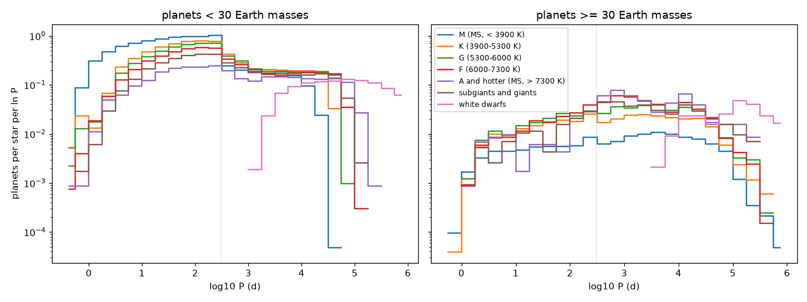
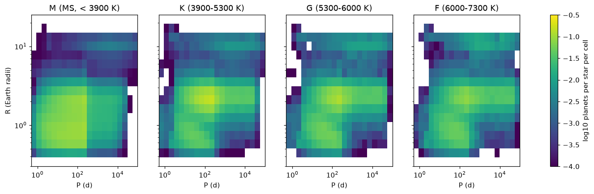
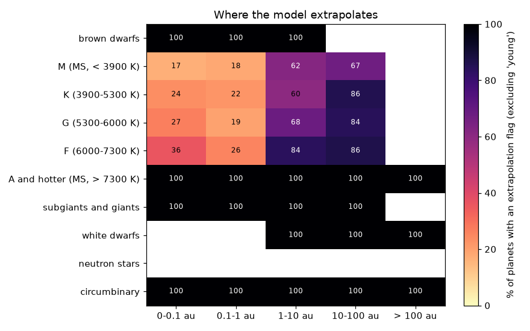

# Phase 4 report (generated)

Generated by `python -m starsys.validation.report --systems 300000` on 2026-10-15: 300,000 systems from the stellar population, 1,634,621 planets, all planet models at their defaults. Rates are intrinsic (no detection model). The verdicts and context are in [planets.md](planets.md).

Runtime per 100,000 systems: stars 1.3 s, planets 26.0 s (first use also builds the cached HM-C edge and binary boost tables).

## Planets by host type (S-type, per star)

| hosts | stars | planets/star | % with planets | inner (HM-C) | giants | outer small |
|---|---|---|---|---|---|---|
| brown dwarfs | 76909 | 0.853 | 20 | 0.801 | 0 | 0.0504 |
| M (MS, < 3900 K) | 218032 | 5.28 | 71.1 | 4.45 | 0.0544 | 0.755 |
| K (3900-5300 K) | 44057 | 4.04 | 73.8 | 2.72 | 0.136 | 1.14 |
| G (5300-6000 K) | 14147 | 3.75 | 74.8 | 2.33 | 0.216 | 1.15 |
| F (6000-7300 K) | 11495 | 3.26 | 73 | 1.86 | 0.272 | 1.09 |
| A and hotter (MS, > 7300 K) | 2013 | 1.98 | 59.2 | 0.805 | 0.308 | 0.829 |
| subgiants and giants | 2005 | 2.57 | 67.4 | 1.34 | 0.218 | 0.993 |
| white dwarfs | 17465 | 0.785 | 42.8 | 0 | 0.143 | 0.642 |
| neutron stars | 535 | 0 | 0 | 0 | 0 | 0 |
| circumbinary (per inner pair) | 91885 | 0.563 | 40.7 | 0.0397 | 0.0281 | 0.14 |

## Kepler: inner planets vs the published HM-C catalogs

Mock magnitude-limited Kepler sample (binaries included, Teff reweighted to HM-C's Kepler targets); published: catalogs 1-20 (mean; z uses their spread).

|  | model | published HM-C | posterior SD |
|---|---|---|---|
| planets per star, 3-300 d | 2.34 | 2.38 | 0.11 |

Model / published, planets per star per cell:

|  | 3-10 d | 10-30 d | 30-100 d | 100-300 d |
|---|---|---|---|---|
| 0.5-1 Re | 1.17 | 1.09 | 0.98 | 0.93 |
| 1-1.5 Re | 1.03 | 0.91 | 0.85 | 0.89 |
| 1.5-2 Re | 0.99 | 1.02 | 1.01 | 0.97 |
| 2-3 Re | 1.17 | 1.06 | 0.99 | 0.95 |
| 3-4 Re | 1.04 | 1.00 | 0.96 | 0.89 |
| 4-6 Re | 1.05 | 1.05 | 0.85 | 0.85 |
| 6-10 Re | 0.87 | 0.84 | 0.91 | 0.89 |

z = (model - published) / posterior SD:

|  | 3-10 d | 10-30 d | 30-100 d | 100-300 d |
|---|---|---|---|---|
| 0.5-1 Re | 0.9 | 0.6 | -0.1 | -0.3 |
| 1-1.5 Re | 0.4 | -0.8 | -0.9 | -0.3 |
| 1.5-2 Re | -0.1 | 0.2 | 0.1 | -0.2 |
| 2-3 Re | 1.4 | 0.7 | -0.1 | -0.3 |
| 3-4 Re | 0.3 | 0.0 | -0.2 | -0.3 |
| 4-6 Re | 0.2 | 0.2 | -0.6 | -0.5 |
| 6-10 Re | -0.3 | -0.3 | -0.2 | -0.2 |

## Early M dwarfs (0.35-0.65 Msun, mock Kepler sample)

| rate | model | observed |
|---|---|---|
| DC15: 1-4 Re, P < 200 d | 2.58 | 2.5 +- 0.2 |
| Hsu+2020: 1-2.5 Re, 2-32 d | 0.904 | 0.9 +0.2/-0.1 (Dirichlet) to 1.6 +0.3/-0.2 (uniform) |
| Hsu+2020: 0.5-4 Re, 0.5-256 d | 3.78 | 4.2 +0.6/-0.6 (Dirichlet) to 8.4 +1.2/-1.1 (uniform) |

## CLS: effectively single Sun-like stars (24,235 stars, M sin i)

| rate | model | observed |
|---|---|---|
| 2-8 au, 30-6000 Me (per 100 stars) | 10.1 | 14.1 +2.0/-1.8 (Fulton+2021) |
| 8-32 au, 30-6000 Me (per 100 stars) | 7.94 | 8.9 +3.0/-2.4 (Fulton+2021) |
| % stars with a giant at 0.23-10 au | 17.6 | 17.6 +2.4/-1.9 (Rosenthal+2022) |
| % stars with a hot Jupiter | 0.834 | ~1 (RV) |

## Giant-planet correlations (cold giants: 1-10 au, M sin i 0.5-20 MJ; single stars)

| Sun-like hosts (0.7-1.3 Msun) | % with cold giant | % with cold giant, given an inner 1-4 Re planet | observed (% with cold giant) |
|---|---|---|---|
| [Fe/H] > 0 | 12.3 | 11.2 | 14.3 +2.0/-1.8 (Bryan & Lee 2024) |
| [Fe/H] <= 0 | 5.9 | 5.56 | 5.0 +1.6/-1.3 |
| all | 8.47 | 7.87 | 9.8 +0.9/-0.8 (Bonomo+2025, CLS-like sample) |

Bonomo+2025: P(CJ | SE) consistent with P(CJ) at average metallicity; Bryan & Lee 2024: 28 +- 7% vs 14% for metal-rich stars.

| M* (Msun) | stars | % with cold giant |
|---|---|---|
| 0.1-0.3 | 86046 | 1.63 |
| 0.3-0.6 | 59302 | 3.88 |
| 0.6-0.9 | 20917 | 6.33 |
| 0.9-1.2 | 10539 | 9.39 |
| 1.2-1.6 | 3204 | 15.3 |
| 1.6-2.5 | 972 | 15.5 |
| 2.5-4.0 | 181 | 4.42 |

## Where the model extrapolates

| flag | % of planets |
|---|---|
| colour | 1.3 |
| young | 1.9 |
| multiple | 14.2 |
| substellar | 8.9 |
| giant_host | 0.2 |
| bridge | 4.1 |
| cold_extrapolated | 8.0 |
| circumbinary | 3.2 |
| evolved | 1.2 |
| pulsar | 0.0 |
| post_interaction | 0.2 |
| short_period | 0.4 |
| hz_extrapolated | 7.2 |
| kozai | 0.9 |
| any | 36.2 |
| any except young | 35.0 |

Share (%) of planets with any extrapolation flag other than `young`, by host and semi-major axis (present-day orbits):

|  | 0-0.1 au | 0.1-1 au | 1-10 au | 10-100 au | > 100 au |
|---|---|---|---|---|---|
| brown dwarfs | 100 | 100 | 100 |  |  |
| M (MS, < 3900 K) | 17 | 18 | 62 | 67 |  |
| K (3900-5300 K) | 24 | 22 | 60 | 86 |  |
| G (5300-6000 K) | 27 | 19 | 68 | 84 |  |
| F (6000-7300 K) | 36 | 26 | 84 | 86 |  |
| A and hotter (MS, > 7300 K) | 100 | 100 | 100 | 100 | 100 |
| subgiants and giants | 100 | 100 | 100 | 100 |  |
| white dwarfs |  |  | 100 | 100 | 100 |
| neutron stars |  |  |  |  |  |
| circumbinary | 100 | 100 | 100 | 100 | 100 |

Planets per cell:

|  | 0-0.1 au | 0.1-1 au | 1-10 au | 10-100 au | > 100 au |
|---|---|---|---|---|---|
| brown dwarfs | 38156 | 26444 | 997 | 0 | 0 |
| M (MS, < 3900 K) | 427580 | 594546 | 123538 | 5489 | 0 |
| K (3900-5300 K) | 25504 | 105739 | 38111 | 8782 | 0 |
| G (5300-6000 K) | 5458 | 30147 | 12953 | 4429 | 0 |
| F (6000-7300 K) | 3118 | 19773 | 10334 | 4298 | 0 |
| A and hotter (MS, > 7300 K) | 252 | 1436 | 1392 | 901 | 1 |
| subgiants and giants | 317 | 2505 | 1567 | 763 | 0 |
| white dwarfs | 0 | 0 | 2839 | 8596 | 2276 |
| neutron stars | 0 | 0 | 0 | 0 | 0 |
| circumbinary | 101 | 5278 | 17966 | 26565 | 1860 |

