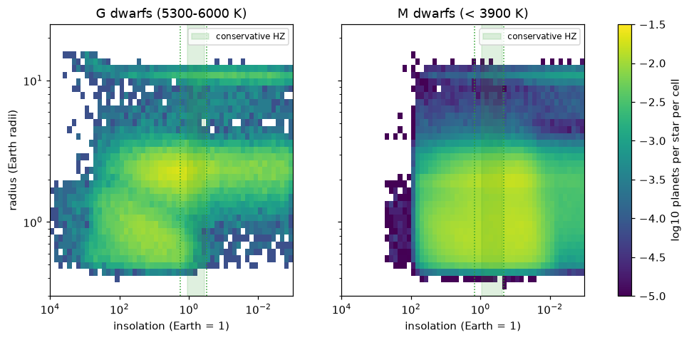

# Phase 5 report (generated)

Generated by `python -m starsys.validation.report5 --systems 300000` on 2026-10-15: 300,000 systems, 1,629,483 planets, 267,946 moons, all models at their defaults. Verdicts and context: [phase5.md](phase5.md).

Runtime per 100,000 systems: planets (with derived properties and Kozai-Lidov) 23.2 s, moons 0.08 s.

## Formulae against the NASA Exoplanet Archive

| quantity | planets | median ratio | 16th pct | 84th pct |
|---|---|---|---|---|
| insolation L/a^2 vs pl_insol | 5589 | 1 | 0.922 | 1.1 |
| T_eq (A = 0) vs pl_eqt | 5629 | 1.03 | 0.99 | 1.14 |

## Known planets

| planet | insolation | T_eq (K) | HZ | t_lock (Gyr) | spin | HZ extrapolated |
|---|---|---|---|---|---|---|
| Mercury | 6.82 | 411 | too hot | 0.543 | 3:2 | False |
| Venus | 1.91 | 299 | too hot | 22.5 | free | False |
| Earth | 1 | 255 | conservative | 165 | free | False |
| Mars | 0.432 | 206 | conservative | 1.47e+03 | free | False |
| Jupiter | 0.037 | 112 | too cold | 4.03e+08 | free | False |
| Saturn | 0.011 | 82.5 | too cold | 7.65e+09 | free | False |
| Proxima Cen b | 0.659 | 229 | conservative | 0.000134 | synchronous | False |
| TRAPPIST-1 e | 0.646 | 228 | conservative | 1.14e-05 | synchronous | True |
| TRAPPIST-1 f | 0.373 | 199 | conservative | 5.98e-05 | synchronous | True |
| TRAPPIST-1 g | 0.252 | 180 | conservative | 0.000198 | synchronous | True |

## Insolation and radius

## Habitable-zone planets per main-sequence star (S-type)

| hosts | stars | cons. HZ, 0.5-1.5 Re | cons. HZ, 1.5-2.5 Re | cons. HZ, all sizes | opt. HZ, 0.5-1.5 Re | % of cons. HZ planets locked | % of cons. HZ planets with T_eq 200-300 K |
|---|---|---|---|---|---|---|---|
| M (< 3900 K) | 192159 | 0.544 | 0.271 | 0.913 | 0.786 | 88.7 | 65.5 |
| K (3900-5300 K) | 43330 | 0.154 | 0.366 | 0.718 | 0.25 | 17.1 | 76.7 |
| G (5300-6000 K) | 14088 | 0.0579 | 0.205 | 0.401 | 0.131 | 0.195 | 94 |
| F (6000-7200 K) | 11298 | 0.0292 | 0.11 | 0.25 | 0.0542 | 0 | 99.4 |

## Spin states

| hosts / P (d) | planets | % synchronous | % 3:2 |
|---|---|---|---|
| M (< 3900 K) / 0-10 | 238991 | 94.7 | 5.3 |
| M (< 3900 K) / 10-100 | 398470 | 88.3 | 5.0 |
| M (< 3900 K) / 100-1000 | 277215 | 17.6 | 0.9 |
| M (< 3900 K) / 1000-inf | 101833 | 0.0 | 0.0 |
| K (3900-5300 K) / 0-10 | 17707 | 85.1 | 14.9 |
| K (3900-5300 K) / 10-100 | 63589 | 65.4 | 13.8 |
| K (3900-5300 K) / 100-1000 | 58276 | 6.8 | 1.3 |
| K (3900-5300 K) / 1000-inf | 34665 | 0.0 | 0.0 |
| G (5300-6000 K) / 0-10 | 4559 | 81.1 | 18.9 |
| G (5300-6000 K) / 10-100 | 18231 | 61.7 | 17.5 |
| G (5300-6000 K) / 100-1000 | 17823 | 6.6 | 1.7 |
| G (5300-6000 K) / 1000-inf | 12425 | 0.0 | 0.0 |
| F (6000-7200 K) / 0-10 | 2783 | 77.1 | 22.9 |
| F (6000-7200 K) / 10-100 | 11940 | 57.6 | 21.5 |
| F (6000-7200 K) / 100-1000 | 12095 | 5.3 | 2.0 |
| F (6000-7200 K) / 1000-inf | 10080 | 0.0 | 0.0 |

## Kozai-Lidov cycles

| quantity | value |
|---|---|
| share of S-type planets cycling | 0.0092 |
| share of giants (>= 0.3 MJup) cycling | 0.0317 |
| mean e, cycling planets | 0.213 |
| share of cycling planets with e > 0.5 | 0.121 |
| planets removed by the cycles (per 1000 planets) | 4.86 |

| sample | planets | mean e | e > 0.6 (%) |
|---|---|---|---|
| NASA archive RV, single | 332 | 0.25 | 9.04 |
| NASA archive RV, with stellar companion | 74 | 0.317 | 14.9 |
| model, no stellar companion | 2167 | 0.213 | 3.41 |
| model, stellar companion < 2000 au | 1009 | 0.217 | 4.26 |

## Moons

Solar System analogues (2000 draws each):

| planet | % with moons | median N (if any) | median mass ratio (if any) | kinds | observed |
|---|---|---|---|---|---|
| Mercury | 0 | 0 |  | - | none |
| Venus | 8.05 | 1 | 0.0125 | impact | none |
| Earth | 9.05 | 1 | 0.0112 | impact | Moon, 0.0123 at 60 Re |
| Mars | 8.75 | 1 | 0.0126 | impact | Phobos, Deimos (captured, ~2e-8) |
| Jupiter | 81.8 | 3 | 0.000192 | regular | 4 regular, 2.1e-4, 5.9-26 Rp |
| Saturn | 78.8 | 3 | 0.00022 | regular | Titan + 6 mid-size, 2.5e-4, 3-59 Rp |
| Uranus | 85 | 3 | 0.000148 | captured, regular | 5 regular, 1.0e-4, 5-23 Rp |
| Neptune | 83.8 | 3 | 0.000154 | captured, regular | Triton (captured, retrograde), 2.1e-4, 14 Rp |

Galilean-analogue moons of warm planets (Teachey+2018):

| planets | n | model eta | Teachey+2018 |
|---|---|---|---|
| 1-11 Re | 114467 | 0.0336 | < 0.38 (95%), 0.16 +0.13 -0.10 |
| 4-11 Re | 3612 | 0.448 | < 0.38 (95%), 0.16 +0.13 -0.10 |
| > 6 Re | 2642 | 0.614 | < 0.38 (95%), 0.16 +0.13 -0.10 |

Survival vs orbit:

| a (au) | giants | % giants with moons | % rocky with impact moon (M) | % rocky with impact moon (FGK) |
|---|---|---|---|---|
| 0-0.1 | 1576 | 11.4 | 0.0 | 0.0 |
| 0.1-0.3 | 1823 | 65.0 | 1.3 | 0.0 |
| 0.3-1 | 3395 | 78.7 | 7.6 | 4.4 |
| 1-3 | 4651 | 78.7 | 8.4 | 8.0 |
| 3-10 | 5647 | 79.8 | 8.3 | 8.6 |
| 10-inf | 7004 | 79.4 | 8.0 | 7.9 |

| kind | moons per 1000 planets | median mass (Earth) | median a (planet radii) | % icy |
|---|---|---|---|---|
| regular | 142 | 0.00192 | 10.9 | 49.5 |
| impact | 15.5 | 0.00767 | 44.3 | 0 |
| captured | 6.9 | 0.00186 | 14.2 | 100 |
| moons >= 0.1 Earth masses in the conservative HZ, per 1000 main-sequence stars | 2.77 |  |  |  |

## Flags

| flag | % of planets |
|---|---|
| colour | 1.3 |
| young | 1.9 |
| multiple | 14.2 |
| substellar | 8.9 |
| giant_host | 0.2 |
| bridge | 4.1 |
| cold_extrapolated | 8.0 |
| circumbinary | 3.2 |
| evolved | 1.2 |
| pulsar | 0.0 |
| post_interaction | 0.2 |
| short_period | 0.2 |
| hz_extrapolated | 7.3 |
| kozai | 0.9 |
| any | 36.2 |
| any except young | 34.9 |

Every moon carries the `moon` flag and its planet's flags.
